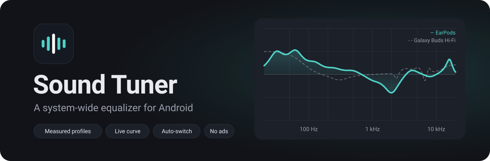
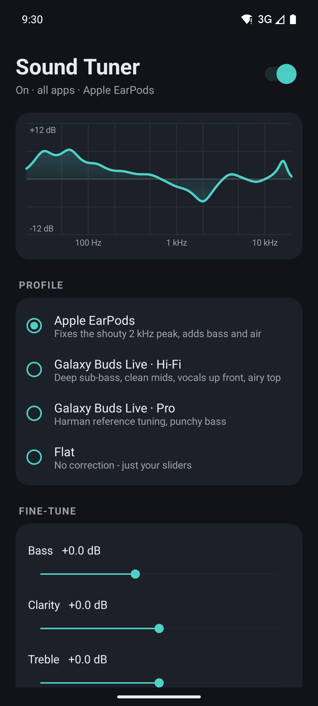
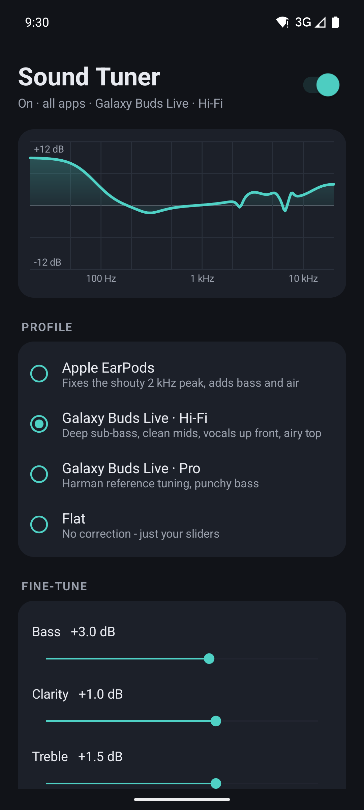
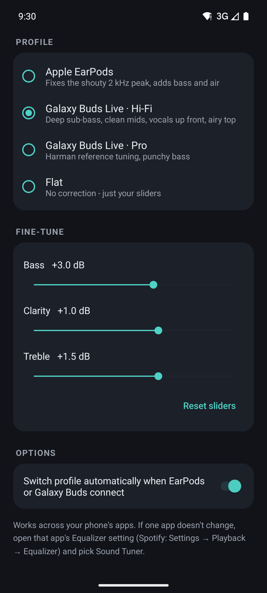
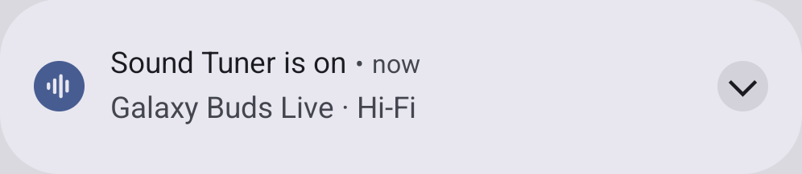
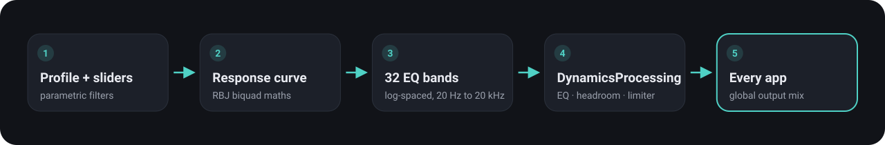

<p align="center">
  
</p>

<p align="center">
  
  
  
  
  
</p>

<p align="center">
  <b>Make everyday earbuds sound like expensive ones.</b><br>
  Measured correction profiles, three simple sliders, and it works in every app.
</p>

<p align="center">
  
  &nbsp;
  
  &nbsp;
  
</p>

---

## Why

Most earbuds aren't tuned well. Apple EarPods have a harsh peak around 2 kHz that makes them sound shouty and cheap.
Open-fit buds like the Galaxy Buds Live lose bass in real ears and can sound thin and distant.

Sound Tuner fixes this the way audio engineers do: it starts from **lab measurements** of each earphone, corrects
toward a research-backed target curve, and then lets you season it to taste.

## Features

|  |  |
|---|---|
| 🎧 **Measured profiles** | Built from published frequency-response measurements, not guesswork |
| 🌍 **Works in every app** | Hooks into the phone's global audio output, so Spotify, YouTube, games and videos all benefit |
| 🎚️ **Bass · Clarity · Treble** | Fine-tune any profile in 0.5 dB steps |
| 📈 **Live response curve** | See exactly what the EQ does to each frequency as you move a slider |
| 🔄 **Auto-switch** | Plug in EarPods → EarPods profile. Connect Galaxy Buds → Buds profile |
| 🛡️ **Clipping protection** | Automatic headroom plus a limiter, so boosts never crackle or distort |
| 🔁 **Always on** | Comes back by itself after a restart or app update |
| 🎵 **Music-app integration** | Spotify's *Equalizer* button opens Sound Tuner directly |
| 🪶 **Tiny and private** | Plain Android framework: no libraries, no ads, no internet permission |

## Profiles

| Profile | What it fixes | Sound |
|---|---|---|
| **Apple EarPods** | Cuts the shouty 2 kHz peak, fills in the weak bass and dull top | Balanced and smooth |
| **Galaxy Buds Live · Hi-Fi** | Adds back the bass that open-fit buds leak, cleans the mids | Deep sub-bass, vocals up front, airy top |
| **Galaxy Buds Live · Pro** | Targets the Harman in-ear reference curve | Neutral with punchy bass |
| **Flat** | Nothing | Just your sliders |

<p align="center">
  <br>
  <sub>Runs quietly in the background, with a one-tap <i>Turn off</i> in the notification.</sub>
</p>

## How it works

<p align="center">
  
</p>

Each profile is a list of parametric filters (peaking, low-shelf and high-shelf), the same format Equalizer APO and AutoEq use.
Sound Tuner calculates the combined frequency response, samples it into 32 bands and loads them into Android's built-in
[`DynamicsProcessing`](https://developer.android.com/reference/android/media/audiofx/DynamicsProcessing) effect on the global
output mix. Input gain is lowered by the largest boost so the signal never clips, and a limiter catches anything left over.
A small foreground service keeps the effect alive while other apps play.

## Install

**Build from source** (needs Android Studio, or JDK 17+ and the Android SDK with platform 35):

```bash
git clone https://github.com/rajveer-lab/soundcore.git
cd soundcore
./gradlew assembleDebug
adb install -r app/build/outputs/apk/debug/app-debug.apk
```

Or open the folder in Android Studio and press **Run**. Then open Sound Tuner, flip the switch, and allow notifications.

> **Tip:** if one app doesn't change, open that app's Equalizer setting (Spotify: *Settings → Playback → Equalizer*) and choose Sound Tuner.

## Project structure

```
app/src/main/java/dev/soundtuner/
├── EqMath.kt        biquad filter maths and response curve
├── Profiles.kt      built-in earphone profiles
├── EqEngine.kt      filters → DynamicsProcessing bands, session handling
├── EqService.kt     foreground service, headphone auto-switch
├── BootReceiver.kt  turns the EQ back on after a restart or update
├── MainActivity.kt  the app screen
└── CurveView.kt     live response-curve graph
```

## Ideas for later

- Custom profile editor and import of any AutoEq preset
- Quick Settings tile for one-tap on/off
- More earphone profiles

## Credits

Measurement data and starting corrections come from [AutoEq](https://github.com/jaakkopasanen/AutoEq) by Jaakko Pasanen (MIT License),
using measurements by Super Review (EarPods) and HypetheSonics (Galaxy Buds Live). The profiles here are adjusted from those
corrections for real-world fit and a less harsh top end.

## Author

Made by **Rajveer** · [@rajveer-lab](https://github.com/rajveer-lab)
